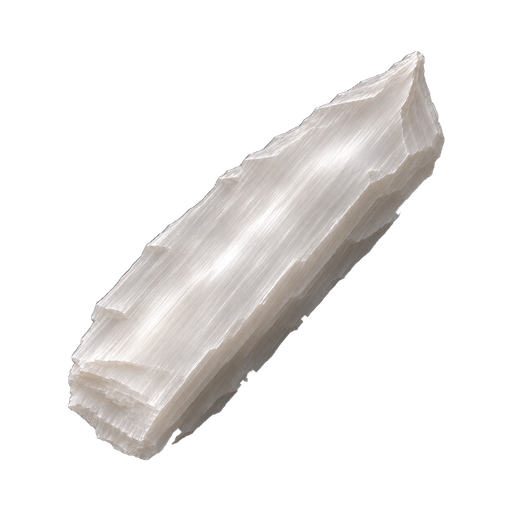

# Selenite brand mark

A thick, raw satin-spar shard set diagonally, with milky silky fibres, a pearly chatoyant band and an off-centre, moderately pointed broken tip.

| File | Size | Use |
|---|---|---|
| `selenite.png` | 1024×1024 | Master, transparent background |
| `selenite-512.png` | 512×512 | README hero |
| `selenite-192.png` | 192×192 | Touch icon |
| `selenite-32.png` | 32×32 | Favicon raster |
| `../icon.png` | 512×512 | Hermes plugin icon (epoch-hermes convention) |
| `selenite-wordmark-ink.svg` / `-pearl.svg` | vector | SELENITE alone, outlined glyphs |
| `selenite-lockup-ink.svg` / `-pearl.svg` | vector | SELENITE over "by KyaniteLabs", outlined glyphs |
| `selenite-lockup-horizontal-ink.png` / `-pearl.png` | 2320×1200 | Mark plus lockup, transparent background |

Part of the KyaniteLabs crystal icon family. Approved at the owner's eye-gate on 2026-11-10. Lockup: **SELENITE** in Chakra Petch Bold 700 with "by KyaniteLabs" in Chakra Petch Medium 500. The reasoning is in `docs/DESIGN-PREFLIGHT.md`.

`ink` (`#3b342e`) is for light grounds and `pearl` (`#ECE9E2`) is for dark ones; only the ink changes. The wordmark files are outlines of Chakra Petch (SIL Open Font License, see `../assets/ChakraPetch-OFL.txt`), so they render without the font installed.
